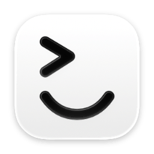

<h1 align="center">
     
    Markwasnice  
</h1>

    Opinionated markdown editor for macOS.  

## Features

- Auto-pairs
- Multi-window and multi-tab support
- Native (Swift, TextKit 1)
- [Lilex](https://github.com/mishamyrt/Lilex) font

## Why is it called that?

Because [Mark was nice](https://www.youtube.com/watch?v=ioxEuSpUMkQ).
